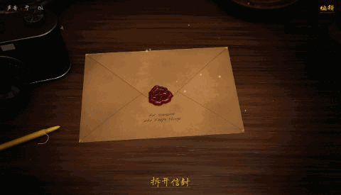

# Film Tins · 胶片铁盒

一张暗房里的桌子：拆开一封旧信，选一个胶片铁盒，把底片拿到灯箱前看，用放大镜、投影机看，在显影盘里把照片冲出来，夹到晾片绳上。桌上还有一台能用的胶片相机，拍下的画面会像真的胶卷一样冲洗出来。

A darkroom table in the browser: open an old letter, pick a film tin, hold the negatives up to a light box, look through a loupe or project them on the wall, develop a print in the tray and clip it on the line. The rangefinder on the table really takes pictures, and they develop like film.



- 做旧的信纸、信封、铁盒、底片，全部是运行时生成的材质 · Aged paper, tins and film, all generated at runtime
- 1 到 6 个铁盒，每个最多 6 张照片；照片背面可以写字，夹在绳上点一下就能翻过来 · 1–6 tins of up to 6 photos; pencil on the back of each print and flip it on the line
- 能用的胶片相机：过片、快门、光圈、对焦、取景器，拍出来带颗粒和日期，冲洗后夹到绳上 · A working film camera: shots get grain and a date stamp, and develop onto the line
- 拆信、纸张、胶片、铁盒、水声和房间底噪，都是合成的，可以一键关掉 · Synthesized sounds, with an off switch
- 中文 / English，跟随浏览器语言，也可以手动切换 · Chinese or English, following the browser
- 电脑横屏、手机竖屏各有一套桌面摆法 · Separate table layouts for wide and tall screens

## 用自己的照片 · Use your own photos

**最简单：在网页里改。** 打开页面后点右上角的「编辑」：

- 改信封上的字、信的内容（中文英文都可以，写多了字会自动变小）
- 每个铁盒最多放 6 张照片，可以上传、排序、拿掉，给每张写一句话
- 改胶带上的字和铁盒颜色
- 改相机冲出来的照片上写的字

这些内容只保存在你自己的浏览器里（IndexedDB），不会上传到任何地方。换电脑前用「导出备份」存一份，到新电脑上「导入备份」。

**The easy way:** open the page and press 编辑 (edit) in the top corner. Change the letter, the tin labels and captions, and upload up to six photos per tin. Everything stays in your own browser; nothing is uploaded. Use 导出备份 / 导入备份 (export / import backup) to move it to another computer.

**做一个带着你照片的版本发给别人 · Ship a version with your photos built in:**

1. 把照片放进 `public/photos/`，比如 `public/photos/beach.jpg`
2. 复制 `src/content.js` 里的 `SAMPLE` 结构，新建 `src/content.local.js`，导出 `LETTER`、`TINS`（4 个铁盒）、`SHOT_CAPTIONS`，照片用文件名引用（`src: 'beach'`）
3. `npm run build`，把 `dist/` 放到任何静态网站托管上

`public/photos/` 和 `src/content.local.js` 都在 `.gitignore` 里，你的照片不会被提交到仓库。没有这两个时，页面会用一组示例内容和自动画出来的占位照片。

Put photos in `public/photos/`, describe them in `src/content.local.js` (same shape as `SAMPLE` in `src/content.js`), then build. Both are git-ignored, so your photos never end up in the repository. Without them the page uses sample words and drawn stand-in photos.

**不用写代码，直接导出一个网站 · No code: export a whole website**

在构建好的网站里（`npm run build` 之后，或者任何已经部署的版本），打开「编辑」→「导出成网站」，会下载一个压缩包，里面是带着你的信和照片的完整网站。解压后把文件夹拖到 [Netlify Drop](https://app.netlify.com/drop) 就能得到网址。可以选择收到的人能不能再编辑。

From any built or deployed copy, 编辑 → 导出成网站 (Export as a website) downloads a zip of a complete site with your letter and photos in it (`content.json` plus `photos/`). Unzip it and drop the folder on Netlify Drop or any static host.

## 运行 · Run

需要 Node.js 18+。

```bash
npm install
npm run dev
```

打开 http://localhost:5183 。

```bash
npm run build
```

输出在 `dist/`，必须通过 http 访问（直接双击 `index.html` 打不开）。`vite.config.js` 里 `base: './'`，所以可以放在任何子路径下，比如 GitHub Pages。

The build in `dist/` must be served over http; `base: './'` means it works from any sub-path (GitHub Pages, Netlify, Vercel, any static host).

**GitHub Pages 自动发布 · Auto-deploy:** 仓库里带了 `.github/workflows/pages.yml`。在仓库 Settings → Pages 里把 Source 选成 GitHub Actions，以后每次推送到 `main` 都会自动构建发布。In Settings → Pages choose "GitHub Actions" as the source; every push to `main` then builds and publishes the sample version.

网址后面加 `?lang=en` 或 `?lang=zh` 可以指定语言。Add `?lang=en` or `?lang=zh` to force a language.

## 说明 · Notes

- 需要支持 WebGL 的浏览器，电脑上体验最好。如果画面很卡，检查浏览器有没有开硬件加速。
- iPhone 的 HEIC 照片请先转成 JPG 再上传。
- 所有材质（木头、纸、铁皮、信封）都是运行时生成的，没有贴图文件。

Needs WebGL; best on a computer with hardware acceleration on. Convert HEIC photos to JPG before uploading. All materials are generated at runtime; there are no texture files.

## 代码结构 · Code

| 文件 | 内容 |
| --- | --- |
| `src/main.js` | 场景、镜头、交互流程 |
| `src/content.js` | 默认文字和照片列表，读取保存的编辑 |
| `src/editor.js` | 页面里的编辑面板、备份、导出成网站 |
| `src/store.js` | 浏览器本地存储（IndexedDB） |
| `src/zip.js` | 导出网站用的压缩包 |
| `src/i18n.js` | 中英文 |
| `src/textures.js` | 信纸、照片、底片、胶带的绘制 |
| `src/envelope.js` | 信封和信 |
| `src/film.js` `src/loupe.js` `src/projector.js` `src/water.js` | 底片、放大镜、投影、显影盘 |
| `src/camera.js` `src/audio.js` | 相机模型和合成音效 |
| `src/bake.js` | 用 GPU 生成木纹、纸、铁皮等材质 |

## 许可 · License

代码：MIT，见 `LICENSE`。用到的库和字体各有自己的许可：three.js (MIT)、GSAP（GreenSock 标准许可，可免费使用）、Vite (MIT)、字体 Nothing You Could Do / Reenie Beanie / Archivo Narrow / Long Cang（SIL Open Font License，通过 Fontsource 引入）。

Code is MIT (see `LICENSE`). Dependencies keep their own licenses: three.js (MIT), GSAP (GreenSock standard no-charge license), Vite (MIT), and the fonts (SIL Open Font License, via Fontsource).
